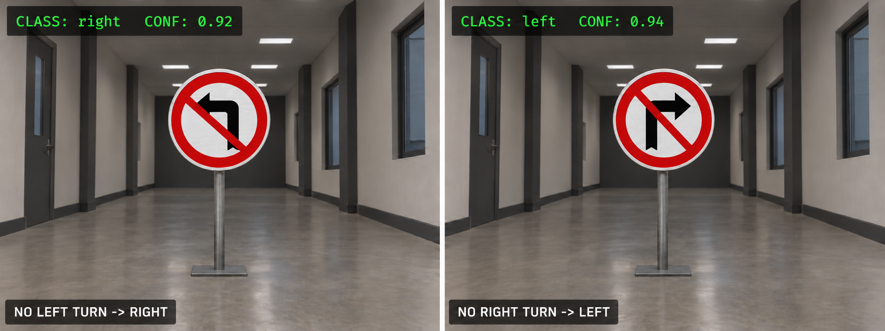

# Traffic-Sign Navigation with YOLO and Nav2

This project makes the rUBot navigate to an inspection pose, read a traffic
sign and choose a safe route according to the detected class. The design keeps
perception and navigation in separate ROS 2 packages:

| Package | Responsibility |
| --- | --- |
| `my_robot_ai_perception` | Camera image to traffic-sign class |
| `my_robot_ai_navigation` | Traffic-sign class to route decision |
| `my_robot_nav_control` | General navigation tools not tied to AI |

The navigation behaviour can be tested without YOLO. This is the recommended
first step in The Construct and before every real-robot test.

## 1. System architecture

```text
/camera/image_raw
        |
        v
traffic_sign_classifier
(my_robot_ai_perception)
        |
        | /traffic_sign  [std_msgs/msg/String]
        v
traffic_sign_navigation
(my_robot_ai_navigation)
        |
        v
       Nav2
```

The source of `/traffic_sign` is interchangeable:

```text
The Construct       ros2 topic pub -----------+
                                                |
Gazebo + YOLO       simulated camera -> YOLO --+--> /traffic_sign
                                                |
Real rUBot          USB camera -> YOLO --------+
```

The accepted values are:

| Message | Navigation behaviour |
| --- | --- |
| `left` | Left waypoint, then final pose |
| `right` | Right waypoint, then final pose |
| `stop` | Wait at the inspection pose, then continue |
| Any other value | Remain at the inspection pose |

This is a route-selection exercise in a known map. It does not estimate the
3D pose of the sign. The left and right waypoints must be configured in known
free areas of the map.

## 2. Build the new packages

Build the perception and AI-navigation packages:

```bash
cd ~/my_rUBot_mecanum
colcon build --symlink-install \
  --packages-select my_robot_ai_perception my_robot_ai_navigation
source install/setup.bash
```

The new implementation does not remove the previous YOLO nodes or launch
files. Both versions can be tested during the migration.

## 3. Configure the navigation route

The route files are located in:

```text
src/AI_Projects/my_robot_ai_navigation/config/
|-- traffic_sign_navigation_sw.yaml
`-- traffic_sign_navigation_real.yaml
```

Each pose uses `[x, y, yaw]` in the `map` frame:

```yaml
traffic_sign_navigation:
  ros__parameters:
    use_sim_time: true
    initial_pose: [-0.5, 0.0, 0.0]
    inspection_pose: [0.0, 0.0, 0.0]
    left_waypoint: [0.5, 1.0, 0.0]
    right_waypoint: [0.5, -1.0, 0.0]
    final_pose: [2.0, 1.0, 1.57]
    stop_duration: 3.0
```

Adapt every pose to the selected world and map. The inspection pose must face
the sign. All goals must be outside occupied and inflated costmap cells.

The navigation sequence is:

```text
initial pose
    |
    v
inspection pose
    |
    v
wait for /traffic_sign
    |-- left  --> left waypoint  --+
    |-- right --> right waypoint --+--> final pose
    |-- stop  --> wait -----------+
    `-- unknown --> remain stopped
```

## 4. Validation in The Construct without Ultralytics

Ultralytics is not required for this test. The terminal simulates the output
of the future YOLO detector.

### 4.1 Start Gazebo Sim

```bash
ros2 launch my_robot_bringup my_robot_bringup_gz.launch.py \
  world:=square_sign_left_ign.world \
  robot_model:=rubot/rubot_mecanum.urdf.xacro \
  x:=-0.5 y:=0.0 yaw:=0.0
```

### 4.2 Start Nav2

```bash
ros2 launch my_robot_navigation2 navigation2_robot.launch.py \
  use_sim_time:=true \
  map_file:=map_square_sign_ign.yaml \
  params_file:=rubot_sw_lidar_ign_ai.yaml
```

`rubot_sw_lidar_ign_ai.yaml` is the simulation Nav2 configuration selected
for this AI-navigation experiment. It uses simulation time, the mecanum motion
model and the LiDAR-oriented controller and costmap settings validated with
the traffic-sign world.

Check the robot localization in RViz before continuing.

### 4.3 Start traffic-sign navigation

```bash
ros2 launch my_robot_ai_navigation traffic_sign_navigation.launch.py \
  config_file:=traffic_sign_navigation_sw.yaml
```

Wait until the robot reaches the inspection pose and the terminal shows:

```text
Waiting for a traffic sign on /traffic_sign ...
```

### 4.4 Simulate the classification result

Publish one message from another sourced terminal:

```bash
ros2 topic pub --once /traffic_sign std_msgs/msg/String "{data: left}"
```

Restart the complete navigation test and repeat it with:

```bash
ros2 topic pub --once /traffic_sign std_msgs/msg/String "{data: right}"
ros2 topic pub --once /traffic_sign std_msgs/msg/String "{data: stop}"
ros2 topic pub --once /traffic_sign std_msgs/msg/String "{data: unknown}"
```

Use these commands to inspect the interface:

```bash
ros2 topic info /traffic_sign
ros2 topic echo /traffic_sign
```

This test validates the route configuration, subscriber, decision logic and
Nav2 integration independently of the camera and YOLO.

## 5. Optional Gazebo validation with YOLO

Run this section on a local system or container where Ultralytics is already
available. The Construct test in the previous section remains the required
fallback.

Install the Python dependencies only as described in
[05a Project Traffic Signs: YOLO Model](./05a_Project_TrafficSigns_YOLO_Model.md#installation).

First verify the simulated camera topic:

```bash
ros2 topic list | grep image
ros2 topic hz /camera/image_raw
```

Start the simple classifier interface:

```bash
ros2 launch my_robot_ai_perception traffic_sign_classifier.launch.py \
  config_file:=traffic_sign_classifier_sw.yaml
```

The launch opens `rqt_image_view` on `/traffic_sign/image` by default. This
topic contains the camera image annotated with the YOLO classification and is
the same in simulation and on the real robot.

To inspect the raw simulated image instead:

```bash
ros2 launch my_robot_ai_perception traffic_sign_classifier.launch.py \
  config_file:=traffic_sign_classifier_sw.yaml \
  view_topic:=/camera/image_raw
```

To run without a graphical viewer:

```bash
ros2 launch my_robot_ai_perception traffic_sign_classifier.launch.py \
  config_file:=traffic_sign_classifier_sw.yaml \
  show_image:=false
```

The node publishes:

| Topic | Type | Purpose |
| --- | --- | --- |
| `/traffic_sign` | `std_msgs/msg/String` | Stable normalized class |
| `/traffic_sign/image` | `sensor_msgs/msg/Image` | Annotated image |

The following illustrative figure shows the expected camera view at the
inspection pose and the classification overlay published on
`/traffic_sign/image`:



The manual `ros2 topic pub` command used in The Construct publishes only the
class message; it does not create an annotated image. The overlay is generated
by `my_robot_ai_perception` when it processes a real or simulated camera image.

Verify the classifier before starting autonomous navigation. The annotated
image viewer is already opened by the classifier launch:

```bash
ros2 topic echo /traffic_sign
```

Then start `traffic_sign_navigation.launch.py` as in Section 4.3. The
navigation node is unchanged: only the publisher of `/traffic_sign` has been
replaced.

## 6. Validation with the real rUBot

Perform the validation in stages. Do not diagnose navigation and perception
at the same time.

### 6.1 Start and verify the hardware

```bash
ros2 launch my_robot_bringup my_robot_bringup_robust_hw.launch.py
```

Check the essential interfaces:

```bash
ros2 topic hz /scan
ros2 topic hz /odom
ros2 topic list | grep image_raw
```

The default YOLO camera topic is `/image_raw`. Use the topic reported by the
last command if the camera driver uses a different name.

### 6.2 Start localization and Nav2

```bash
ros2 launch my_robot_navigation2 navigation2_robot.launch.py \
  use_sim_time:=false \
  map_file:=my_map.yaml \
  params_file:=rubot_real_lidar_ai.yaml
```

`rubot_real_lidar_ai.yaml` is the corresponding hardware configuration. Keep
`use_sim_time:=false` and verify the real robot localization before starting
the traffic-sign route.

Place the physical robot at the configured initial pose. Verify its pose and
costmaps in RViz. Use **2D Pose Estimate** when necessary.

### 6.3 Validate navigation with a manual message

Start the real route configuration:

```bash
ros2 launch my_robot_ai_navigation traffic_sign_navigation.launch.py \
  config_file:=traffic_sign_navigation_real.yaml
```

When the robot reaches the inspection pose, publish:

```bash
ros2 topic pub --once /traffic_sign std_msgs/msg/String "{data: left}"
```

Do not continue until the inspection, left, right, stop and unknown cases are
safe with manual messages.

### 6.4 Add the real YOLO classifier

Start the detector with the real camera topic:

```bash
ros2 launch my_robot_ai_perception traffic_sign_classifier.launch.py \
  config_file:=traffic_sign_classifier_real.yaml
```

The default viewer still displays `/traffic_sign/image`. To inspect the raw
hardware camera image, add `view_topic:=/image_raw`.

Before moving the robot, show each sign to the camera and verify:

```bash
ros2 topic echo /traffic_sign
```

Finally, restart `traffic_sign_navigation.launch.py` and execute the complete
camera-to-navigation experiment.

## 7. Troubleshooting

| Symptom | Check |
| --- | --- |
| No `/traffic_sign` with manual publication | Source the workspace and check topic type/name |
| Robot does not leave the inspection pose | Publish only after the waiting message appears |
| Goal is rejected | Check the pose in the global costmap and inflation layer |
| Wrong route is selected | Check lower-case values: `left`, `right`, `stop` |
| No camera images | Check the actual `image_raw` topic and camera device |
| YOLO produces no class | Reduce confidence temporarily and inspect the annotated image |
| Detection changes rapidly | Increase `stable_frames` |
| Simulation waits forever | Check `use_sim_time`, `/clock` and that Nav2 is active |

Test each layer separately in this order:

```text
Nav2 goal
  -> manual /traffic_sign
  -> YOLO topic output
  -> complete integrated system
```
