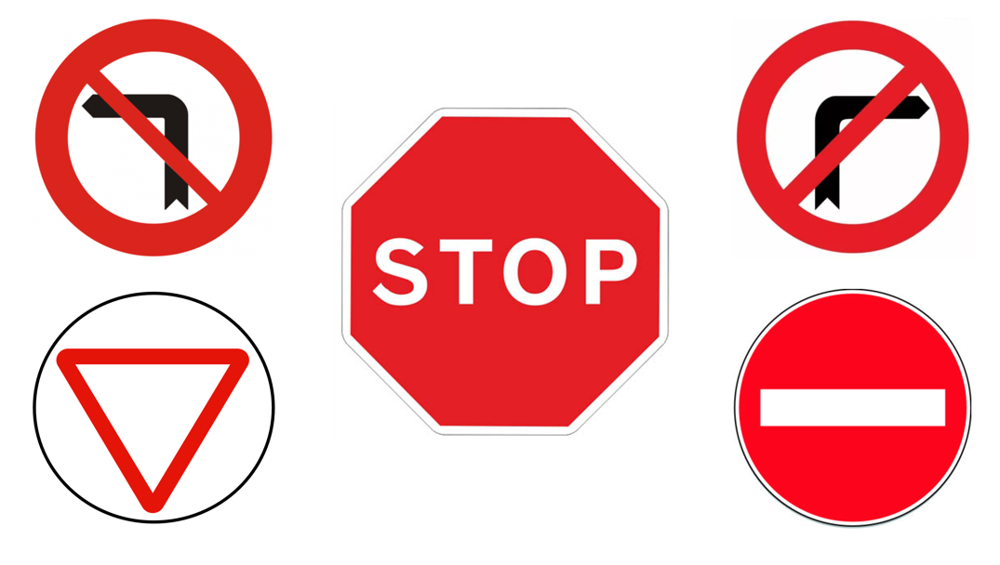

# YOLO Traffic Sign Classification Model

This guide explains how to collect images, prepare a dataset, and train a
traffic sign classification model. Classification returns one class for each
image. It does not return a sign location or bounding box.

The shared installation and model verification steps are in the
[traffic sign YOLO documentation](../../../Documentation/05a_Project_TrafficSigns_YOLO_Model.md).

## Classes

The dataset uses these six class names:

- `Stop`
- `Right`
- `Left`
- `Give`
- `Nothing`
- `Forbidden`

`Right` and `Left` describe the navigation action selected by a sign:

| Sign          | Class     | Navigation action   |
| ------------- | --------- | ------------------- |
| No left turn  | `Right` | Use the right route |
| No right turn | `Left`  | Use the left route  |



## Before you start on Windows

Open PowerShell in the repository root (`my_rUBot_mecanum`). Create the
environment and install the packages once. Python 3.11 must be installed. If
you use another compatible Python version, replace `3.11` in the command:

```powershell
py -3.11 -m venv .venv-yolo
Set-ExecutionPolicy -Scope Process -ExecutionPolicy Bypass
.\.venv-yolo\Scripts\Activate.ps1
python -m pip install --upgrade pip
python -m pip install "ultralytics>=8.3" "numpy<2.0"
```

Run `Set-ExecutionPolicy` in every new PowerShell window before activating the
environment. It only affects that window and does not change the computer-wide
policy. Keep the environment active while following the commands below. The
shared [YOLO documentation](../../../Documentation/05a_Project_TrafficSigns_YOLO_Model.md)
has installation notes for Ubuntu and ROS 2.

## 1. Create the work folders

From the repository root, run:

```powershell
python tools/yolo_model_generation/1_prepare_workspaces.py
```

This creates the class folders for both workflows. Classification photos go
under:

```text
tools/yolo_model_generation/classification/workspace/photos/
|-- Stop/
|-- Right/
|-- Left/
|-- Give/
|-- Nothing/
`-- Forbidden/
```

`3_prepare_dataset.py` is a later step. It resizes and splits the collected
photos for training.
The workspace is local and ignored by Git, so photos and generated models
will not be committed.

## 2. Collect images

Capture about 200 images for each class. Use different positions, distances,
backgrounds, lighting conditions, and viewing angles. Keep the camera and
image quality similar to the conditions expected on the robot.

### Capture from a webcam

In PowerShell, from the repository root, change to the folder for the class
you are capturing. This example saves Stop sign images:

```powershell
Set-Location tools\yolo_model_generation\classification\workspace\photos\Stop
python ..\..\..\2_capture_webcam.py
```

The preview window shows the live camera image. Position the sign, then press
`s` in the preview window to start saving. The terminal prints each saved
photo number and filename, and the window shows the current capture status.
The frame shown when you press `s` is saved as the first photo. The script
saves one image every half second in the current folder. Press
Ctrl+C in the terminal or `q` in the preview window to stop. Repeat from the
matching folder for each class. Do not mix signs from different classes in one folder.
If you restart capture, it continues with the next number instead of
overwriting existing photos. To collect about 100 photos, watch the terminal
and stop when it reaches photo 100.
For the next steps, open a new PowerShell window in the repository root or
return to the repository root and activate the YOLO environment again if
needed.

### Capture from a ROS 2 camera

In `classification/2_capture_ros.py`, set `IMAGE_TOPIC` to the camera topic and
set `OUTPUT_RELATIVE_PATH` to the class folder, for example
`photos/Stop`. Source ROS 2 in the terminal, then run this command from the
repository root:

```bash
python tools/yolo_model_generation/classification/2_capture_ros.py
```

Repeat for each class. The script saves images under
`tools/yolo_model_generation/classification/workspace/photos/`. Its preview
window displays the current saved image and photo number; the terminal prints
the number and filename. Position the sign, then press `s` in the preview
window to save the current frame and start capturing. Press Ctrl+C in the
terminal to stop. If capture is
restarted, it continues with the next number instead of overwriting existing
photos.

## 3. Prepare the dataset

From the repository root, run:

```bash
python tools/yolo_model_generation/classification/3_prepare_dataset.py
```

The script resizes images to 640 by 640 pixels, keeps the image proportions,
and splits each class into 80% training images and 20% validation images. It
creates this folder structure:

```text
tools/yolo_model_generation/classification/workspace/traffic_sign_dataset/
|-- train/
|   |-- Stop/
|   |-- Right/
|   |-- Left/
|   |-- Give/
|   |-- Nothing/
|   `-- Forbidden/
`-- val/
    |-- Stop/
    |-- Right/
    |-- Left/
    |-- Give/
    |-- Nothing/
    `-- Forbidden/
```

The script requires at least two images in every class folder so each class
can appear in both splits. It will not replace the existing dataset if a class
does not have enough images. When it runs, it rebuilds
`traffic_sign_dataset`; keep the original photos in
`classification/workspace/photos`.

## 4. Train the model

Activate the YOLO Python environment described in the
[shared documentation](../../../Documentation/05a_Project_TrafficSigns_YOLO_Model.md),
then run this command from the repository root:

```bash
python tools/yolo_model_generation/classification/4_train.py
```

Training starts from the pretrained `yolo11n-cls.pt` model. The script trains
for up to 50 epochs using 640-pixel images and saves the best model here:

```text
tools/yolo_model_generation/classification/workspace/runs/classify/train/weights/best.pt
```

The training script uses the CPU by default. Review the training output for
errors and check the saved model before using it.

## 5. Verify the model

The verification scripts use a model in `classification/yolo_models/`. From
the repository root, copy the trained model to the default model location:

```powershell
Copy-Item tools\yolo_model_generation\classification\workspace\runs\classify\train\weights\best.pt `
  tools\yolo_model_generation\classification\yolo_models\yolo11n_cls_g1.pt
```

If the training output or model filename is different, update the model path
in `classification/5_infer_webcam.py` and `classification/5_infer_ros.py`.

To verify with a webcam, run from the repository root:

```bash
python tools/yolo_model_generation/classification/5_infer_webcam.py
```

To verify with a ROS 2 camera, first start the camera, source ROS 2, and run:

```bash
python tools/yolo_model_generation/classification/5_infer_ros.py
```

The ROS 2 script subscribes to `/image_raw` by default. Change the topic with
`--image-topic` if needed. Press `q` in the image window to exit.

See the [main YOLO documentation](../../../Documentation/05a_Project_TrafficSigns_YOLO_Model.md)
for environment setup and additional verification options.
