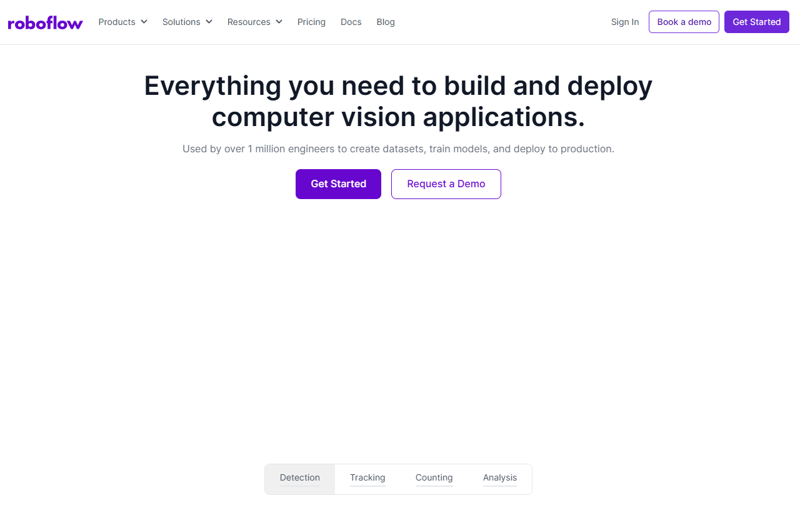
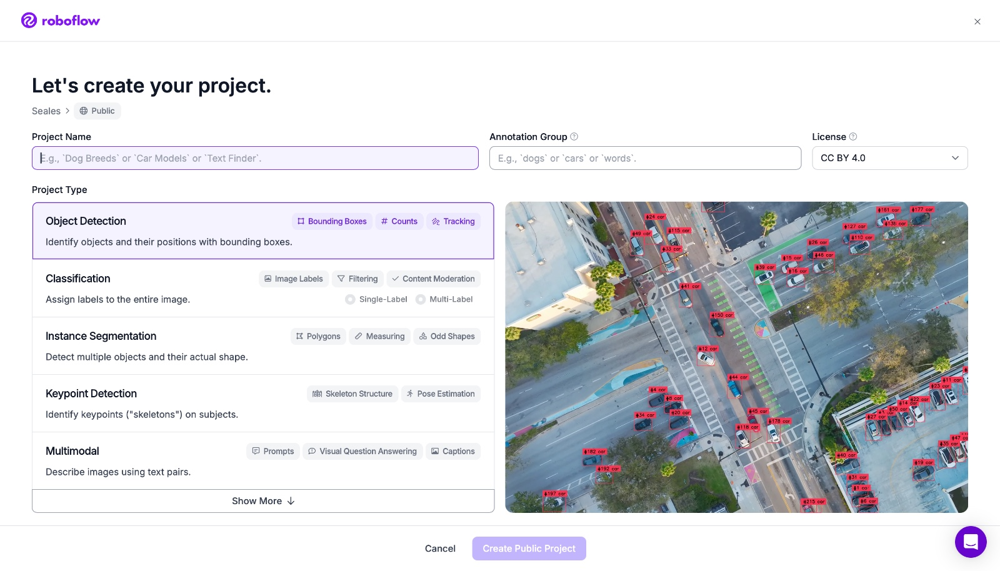
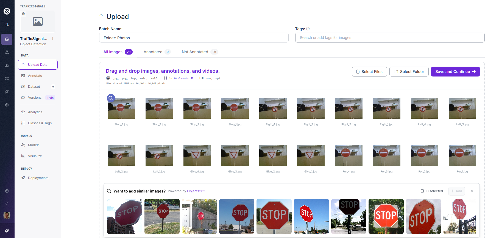
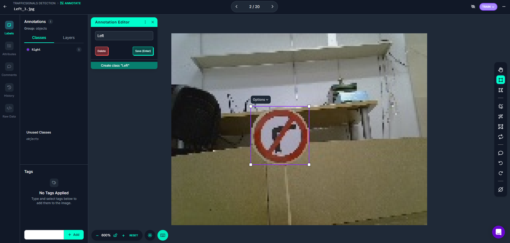
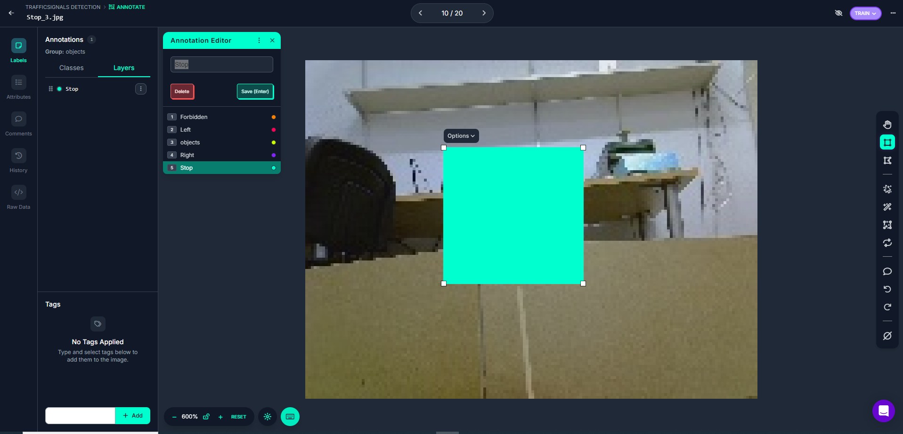
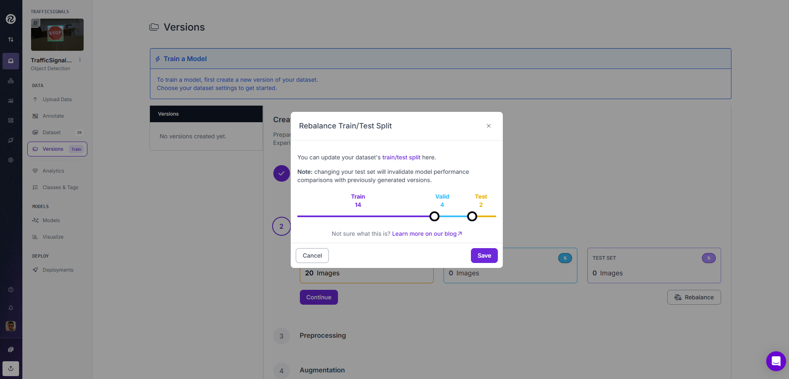
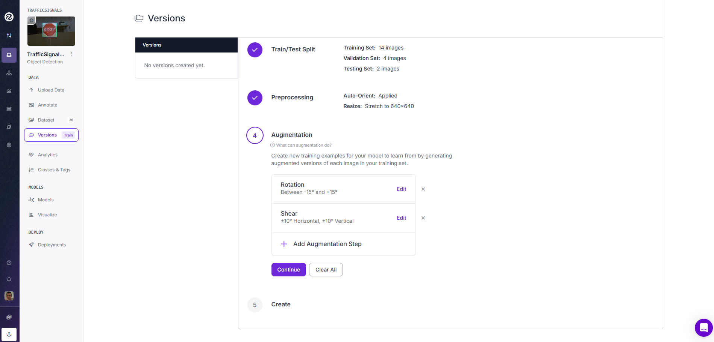
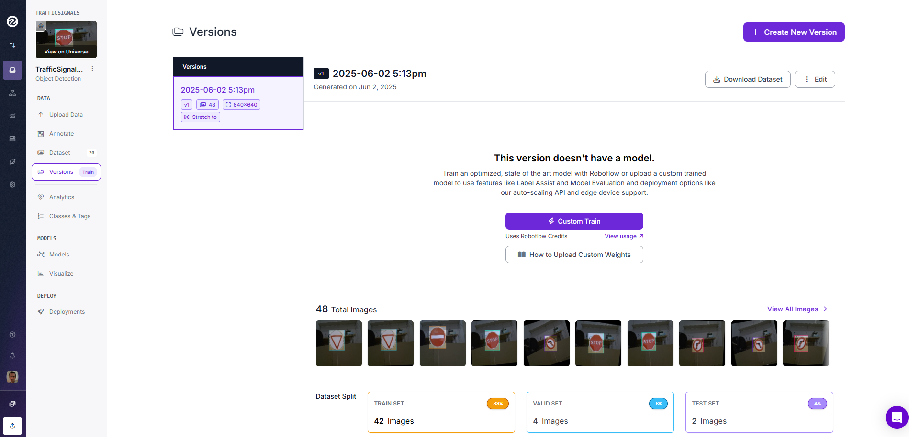
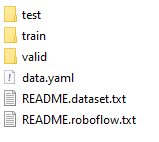

# YOLO Traffic Sign Detection Model

This guide explains how to label traffic sign images, export a detection
dataset, and train a YOLO model. Object detection returns a class and a
bounding box for each sign in an image. It can detect more than one sign in a
frame.

The shared installation and model verification steps are in the
[traffic sign YOLO documentation](../../../Documentation/05a_Project_TrafficSigns_YOLO_Model.md).

## Classes

Use these five classes:

- `Stop`
- `Right`
- `Left`
- `Give`
- `Forbidden`

Do not add `Nothing`: detection datasets label objects, not empty images. The
`Right` and `Left` class names represent the navigation action:

| Sign | Class | Navigation action |
| --- | --- | --- |
| No left turn | `Right` | Use the right route |
| No right turn | `Left` | Use the left route |

## Before you start on Windows

Open PowerShell in the repository root (`my_rUBot_mecanum`). Create the
environment and install the packages once. Python 3.11 must be installed. If
you use another compatible Python version, replace `3.11` in the command:

```powershell
py -3.11 -m venv .venv-yolo
Set-ExecutionPolicy -Scope Process -ExecutionPolicy Bypass
.\.venv-yolo\Scripts\Activate.ps1
python -m pip install --upgrade pip
python -m pip install "ultralytics>=8.3" "numpy<2.0"
```

Run `Set-ExecutionPolicy` in every new PowerShell window before activating the
environment. It only affects that window and does not change the computer-wide
policy. Keep the environment active while following the commands below. The
shared [YOLO documentation](../../../Documentation/05a_Project_TrafficSigns_YOLO_Model.md)
has installation notes for Ubuntu and ROS 2.

## 1. Create the work folders

From the repository root, run:

```powershell
python tools/yolo_model_generation/1_prepare_workspaces.py
```

This creates the folders for detection photos and the Roboflow dataset:

```text
tools/yolo_model_generation/detection/workspace/
|-- photos/
|   |-- Stop/
|   |-- Right/
|   |-- Left/
|   |-- Give/
|   `-- Forbidden/
|-- roboflow/
`-- runs/
```

Use the class folders to keep the original photos organized. Export the
annotated Roboflow dataset into `detection/workspace/roboflow/`.
The workspace is local and ignored by Git, so photos, datasets, and training
outputs will not be committed.

To capture photos with the laptop webcam, open PowerShell at the repository
root, activate `.venv-yolo`, and run the numbered capture script from the
folder for the class. For example:

```powershell
Set-Location tools\yolo_model_generation\detection\workspace\photos\Stop
python ..\..\..\..\classification\2_capture_webcam.py
```

The capture script shows a live preview and prints each saved photo number.
Position the sign, then press `s` in the preview window to start saving. Press
the current frame is saved as the first photo. Press Ctrl+C in the terminal or
`q` in the preview window to stop. Repeat in the folder for each class, then
upload the photos to Roboflow.

## 2. Create a Roboflow project

1. Open [Roboflow](https://roboflow.com/) and sign in or create an account.
2. Create a workspace and a new object detection project.
3. Use **Traditional Model Builder** if Roboflow offers that option.
4. Add the five classes listed above.
5. Upload the traffic sign images from
   `detection/workspace/photos/<ClassName>/`. You can also use photos from the
   classification dataset.

For a first-time overview, see the
[Roboflow introductory tutorial](https://blog.roboflow.com/getting-started-with-roboflow/).





## 3. Label the images

Draw a bounding box around each traffic sign and assign the correct class.
Check every label before continuing. Correct a label if its box or class is
wrong.




## 4. Build and export the dataset

1. Add the labeled images to the dataset.
2. Set a balanced split: 80% for training, 15% for validation, and 5% for
   testing.
3. Add the **Shear** augmentation to include small changes in image geometry.
4. Create the dataset version.
5. Download the dataset as a YOLOv8-format ZIP file. It includes the images,
   labels, and `data.yaml`.






## 5. Install the dataset

Extract the downloaded dataset into:

```text
tools/yolo_model_generation/detection/workspace/roboflow/
```

Make sure `data.yaml` is at:

```text
tools/yolo_model_generation/detection/workspace/roboflow/data.yaml
```

Check that the paths inside `data.yaml` point to the extracted training,
validation, and test images. The training script needs these paths to be valid.
Make sure `data.yaml` is directly inside the `roboflow` folder, not one level
deeper inside another extracted folder. In PowerShell, confirm the file exists:

```powershell
Test-Path tools\yolo_model_generation\detection\workspace\roboflow\data.yaml
```

The command should print `True`.
Run the training and verification commands below from the repository root.
If you opened a new PowerShell window, activate `.venv-yolo` again first.

## 6. Train the model

Activate the YOLO Python environment described in the
[shared documentation](../../../Documentation/05a_Project_TrafficSigns_YOLO_Model.md),
then run this command from the repository root:

```bash
python tools/yolo_model_generation/detection/4_train.py
```

The script starts from the pretrained `yolo11n.pt` model. It trains for up to
50 epochs with 640-pixel images and uses the CPU by default. The best model is
saved here:

```text
tools/yolo_model_generation/detection/workspace/runs/detect/train/weights/best.pt
```

## 7. Verify the model

The verification scripts load the model from the training output path above.
To verify with a webcam, run from the repository root:

```bash
python tools/yolo_model_generation/detection/5_infer_webcam.py
```

To verify with a ROS 2 camera, first start the camera, source ROS 2, and run:

```bash
python tools/yolo_model_generation/detection/5_infer_ros.py
```

The ROS 2 script subscribes to `/image_raw` by default. Change `IMAGE_TOPIC`
in `detection/5_infer_ros.py` if your camera uses a different topic. Press `q`
to close the webcam window; press Ctrl+C to stop the ROS 2 script.

See the [main YOLO documentation](../../../Documentation/05a_Project_TrafficSigns_YOLO_Model.md)
for environment setup and additional verification options.
